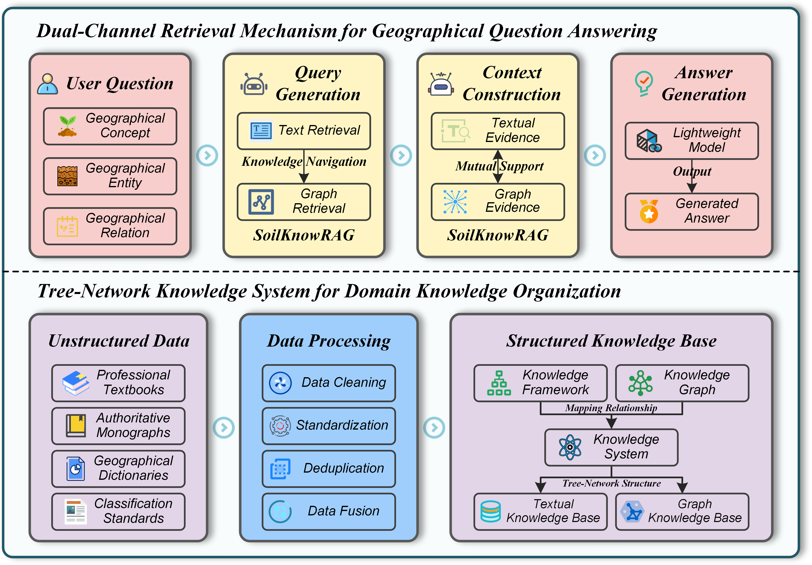

# 🌍 GeoQA-PG: A Knowledge System-Guided Retrieval-Augmented Framework for Geographical Question Answering in Pedogeography

---

## 📖 Abstract

Geographical Question Answering (GeoQA) is transitioning from traditional rule-based and retrieval-based approaches to intelligent paradigms driven by large language models. As an important component of geographic artificial intelligence, GeoQA aims to provide reliable and interpretable geographic knowledge services. However, existing Retrieval-Augmented Generation (RAG) methods remain inadequate for geographic questions requiring structured knowledge and coherent logical reasoning. To address these challenges, this study proposes GeoQA-PG, a question answering framework for pedogeography. Specifically, a tree-network knowledge system is constructed by integrating a hierarchical knowledge
framework with a fine-grained knowledge graph. Building on this knowledge system, a dual-channel retrieval mechanism, named SoilKnowRAG, is developed. It combines text and graph retrieval to mitigate knowledge fragmentation. Based on GeoQA-PG, SoilGPT is implemented and evaluated using a question answering dataset. Experimental results demonstrate that SoilGPT significantly outperforms baseline models with comparable parameter scales on both objective and subjective tasks, while the comparative evaluation of SoilKnowRAG further confirms its effectiveness compared with other RAG methods. Overall, GeoQA-PG provides a transferable framework for knowledge-driven GeoQA and advances the intelligent representation, reasoning, and services of geographic knowledge.

---

## 🚀 Highlights

- A tree-network knowledge system integrates a hierarchical knowledge framework with a fine-grained knowledge graph.
- SoilKnowRAG combines framework-guided text retrieval and graph-based relational retrieval to improve evidence relevance and coherence.
- GeoQA-PG is systematically evaluated on a domain-specific pedogeography QA dataset, demonstrating its effectiveness against baseline models and RAG methods.

---

## 📂 Code Release

Thank you all for your attention. We are actively cleaning our code and will open source the code soon.

---

## 📚 Citation

To cite this article: Shijia Ke , Yi Huang , Yehua Sheng , Ran Tao , Liu Yang , Xiangqiang Min , Jike Chen & Yufei Chen (2026) GeoQA-PG: a knowledge system-guided retrieval-augmented framework for geographical question answering in Pedogeography, International Journal of Digital Earth, 19:2, 2748760, DOI: 10.1080/17538947.2026.2748760